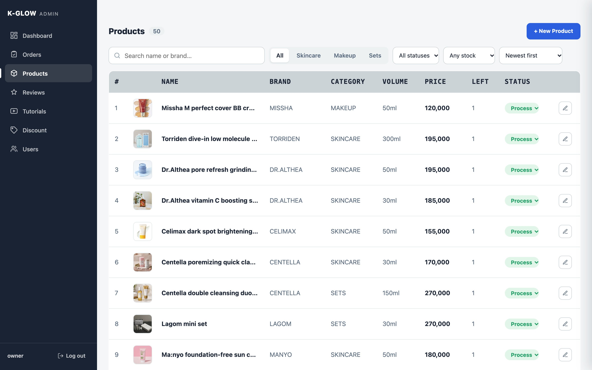

# K-Glow Secrets — Backend

**API and admin panel for a live e-commerce business.** K-Glow Secrets sells original Korean skincare and makeup online and delivers across Uzbekistan. This repository is the server behind the shop: accounts, catalog, orders, the owner's admin panel, and an AI skincare advisor.

**Live shop:** [www.kglowshop.uz](https://www.kglowshop.uz) · **Shop frontend:** [k-glow-react](https://github.com/sanjardev23/k-glow-react)

---

## At a glance

| | |
|---|---|
| **What it is** | The backend of a real, running online shop — not a demo |
| **Who uses it** | Shoppers (through the shop website) and the shop owner (through the admin panel) |
| **My role** | Sole developer — design, frontend, backend, AI integration, hosting and deployment |
| **Built with** | Node.js, TypeScript, Express, MongoDB, Claude AI, AWS |
| **Quality** | 125 automated tests; every change is tested and deployed automatically |

## What it does

- **Shopping** — sign-up and login (password or Google), product catalog with search and filters, reviews, tutorials, discounts, and orders with bank-transfer receipts.
- **Admin panel** — the owner manages orders, products, stock, reviews, tutorials, discounts and customers, with a dashboard of sales and low stock.

  

- **AI Beauty** — a short skin quiz returns a personal morning and evening routine, plus a chat for skincare questions, in Uzbek, Russian and English. It only ever recommends products that are in stock.

## Engineering highlights

- **AI that can't invent products.** Claude returns structured JSON that is validated against a schema, and every product it suggests is checked against live inventory before a shopper sees it.
- **AI cost cut by more than 95%.** Moving to a smaller model, caching the catalog prompt and adding a per-customer daily quota brought the cost of an answer from about 13¢ to well under 1¢, with no visible drop in quality.
- **Correct in three languages.** Answers come back in the shopper's language, with automatic checks that Uzbek text stays in Latin script and uses the right letters.
- **Security by default.** Every input is validated, logins and AI use are rate-limited, passwords are hashed, payment receipts are never publicly reachable, and the server sends strict security headers.
- **Hands-off operations.** Tests run on every push, a passing build deploys itself and is health-checked, and the database is backed up every night with a tested restore path.
- **Tested against a real database.** The suite spins up a throwaway MongoDB per test file, so tests exercise real queries and transactions, not mocks.

## Tech stack

| Area | Technology |
|---|---|
| Language & runtime | TypeScript, Node.js |
| Web framework | Express (JSON API), EJS (admin panel) |
| Database | MongoDB with Mongoose |
| Authentication | JWT, server sessions, Google Sign-In |
| Validation | Zod |
| AI | Anthropic Claude (structured output, prompt caching) |
| Testing | Vitest, Supertest, mongodb-memory-server |
| Infrastructure | AWS, nginx, HTTPS (Let's Encrypt) |
| CI/CD | GitHub Actions |

## Architecture

```
  Shop website (React, Vercel)          Admin panel (browser)
              │                                  │
              └──────────────┬───────────────────┘
                             ▼
                 Express API + admin panel   ──►  MongoDB
                        (this repo)          ──►  Claude AI
                                             ──►  Google Sign-In
```

Every request follows the same path: **route → controller → service → data model**. Input is validated before it reaches the business logic, and the business logic never talks to the web layer.

## Project structure

```
src/
  server.ts          starts the app
  app.ts             security, middleware and routing setup
  router.ts          shop API routes
  router-admin.ts    admin panel routes
  controllers/       handle requests and responses
  models/            business logic (orders, products, AI Beauty, …)
  schema/            database models
  libs/              validation, errors, shared utilities
  views/, public/    admin panel pages and assets
test/                automated tests, one file per area
scripts/             deployment and backup tooling
```

## Running locally

Requires Node.js 22+ and a MongoDB database.

```bash
npm ci
cp .env.example .env     # then fill in your own values
npm run start:dev
```

```bash
npm test                 # full test suite, no database setup needed
```

## License

Source available for review only — **all rights reserved**. See [LICENSE](LICENSE).

## Author

**Sanjar Kurbonaliyev** — full-stack developer
[sanjardevx@gmail.com](mailto:sanjardevx@gmail.com) · [GitHub](https://github.com/sanjardev23)
